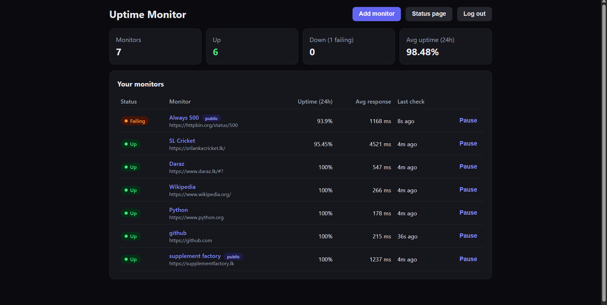
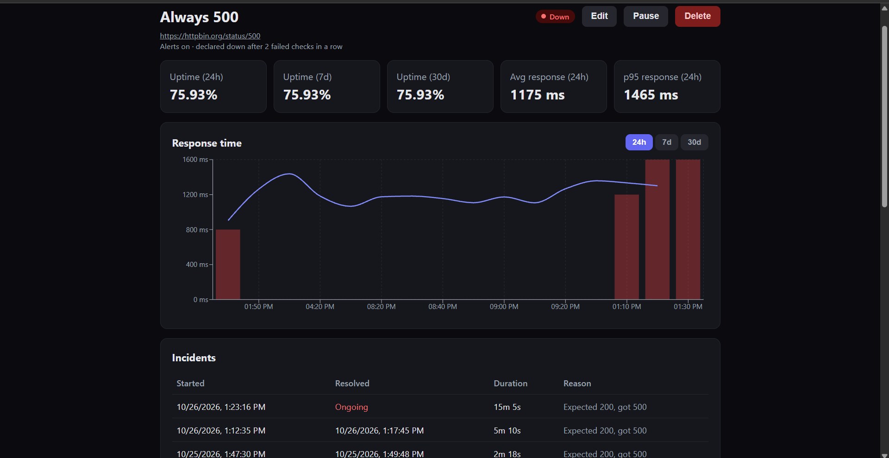
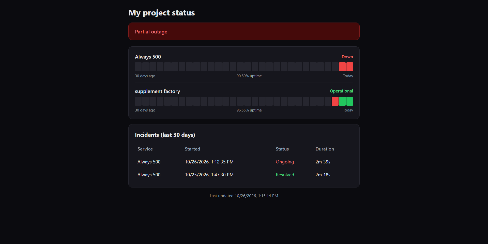
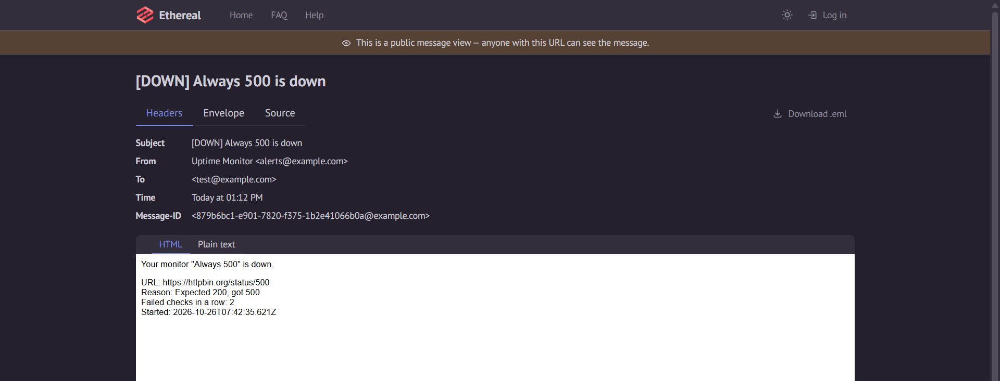
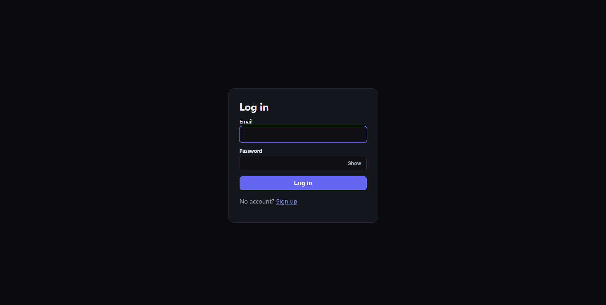

# Uptime Monitor

A full-stack uptime monitoring service. Add a URL and the app checks it on a schedule, records response times, opens an incident when the site goes down, emails you when it fails and when it recovers, and can publish a public status page.

> This project runs locally. See [Running it locally](#running-it-locally) for setup steps.

## Screenshots

| Dashboard | Monitor detail |
|---|---|
|  |  |

*In the monitor detail chart, red bars are failed checks per time bucket and the line is the average response time of successful checks.*

| Public status page | Alert email |
|---|---|
|  |  |

<p align="center">
  
</p>

## Features

- Register and log in with email and password (JWT authentication)
- Monitor any public HTTP or HTTPS URL, with a configurable check interval (1 minute to 1 hour), expected status code and timeout
- Pause and resume monitors, up to 10 monitors per account
- A monitor is only declared **down** after several failed checks in a row (configurable), so one network blip does not cause a false alarm
- Every outage becomes an **incident** with a start time, end time and duration
- Email alerts when a monitor goes down and when it recovers
- Dashboard with summary cards, status badges (Up, Failing, Down, Paused, Pending), 24-hour uptime and average response time
- Monitor detail page with 24-hour, 7-day and 30-day uptime, average and p95 response time, a response-time chart, incident history and recent checks
- Public status page with an overall status banner, 30-day uptime bars per monitor and recent incidents. It never shows URLs or error details
- SSRF protection, so users cannot make the server request internal addresses
- Old check history is deleted automatically after 30 days

## Tech stack

| Layer | Technology |
|---|---|
| Frontend | React (Vite 7), React Router, Recharts, plain CSS |
| Backend | Node.js, Express 5 |
| Database | PostgreSQL (hosted on Neon) |
| Auth | JSON Web Tokens, bcrypt password hashing |
| Validation | Zod |
| Email | Nodemailer |
| Security | helmet, express-rate-limit, CORS allow-list |
| Testing | Node's built-in test runner, supertest |

## How it works

```
React app (browser)  ->  Express REST API  ->  PostgreSQL
                                ^                  ^
                                |                  |
                         Scheduler + checker ------+
                                |
                                v
                        the monitored sites     Nodemailer -> alert emails
```

- **Scheduler.** A loop runs every 5 seconds and claims monitors that are due. The claim is a single `UPDATE ... FOR UPDATE SKIP LOCKED` that also pushes `next_check_at` forward, so two workers can never check the same monitor, and a crash during a check just waits for the next interval.
- **Checker.** Sends a `GET` request with a hard timeout and records the status code, the time until the response headers arrive, and any error. Redirects are not followed.
- **State changes are transactional.** Saving the check, updating the monitor, and opening or closing an incident happen in one transaction with the monitor row locked. Alerts are sent after the commit and never block checks.
- **One open incident per monitor** is enforced by a partial unique index, so even a bug in the code cannot create duplicates.
- **Statistics are computed in SQL.** Uptime uses `COUNT(*) FILTER`, p95 uses `percentile_cont`, and the chart is bucketed with `date_bin` (10 minutes for 24 hours, 1 hour for 7 days, 6 hours for 30 days). The browser only receives about 100 to 200 points.
- **Public status page.** Only monitors the owner publishes appear, paused monitors are hidden, URLs and error text are never selected, and responses are cached in memory for 30 seconds.

### Security

- Passwords are hashed with bcrypt, and login gives the same error for a wrong password and an unknown email.
- Every query is scoped to the logged-in user, so one user can never read or change another user's data.
- **SSRF protection in two layers.** URLs are validated when saved (http and https only, no localhost, private ranges or IPv6 literals). At check time the hostname is resolved, and the connection is refused if any resulting address is private, which also stops public-looking domains that point to `127.0.0.1`.
- helmet security headers, a CORS allow-list, a 10 KB request body limit, and rate limits on all routes, on login and on the public status page.
- Request bodies are validated with Zod, and all SQL uses parameterised queries.

## API endpoints

| Method | Endpoint | Description | Auth |
|---|---|---|---|
| POST | `/auth/register` | Create an account, returns a token | No |
| POST | `/auth/login` | Log in, returns a token | No |
| GET | `/monitors` | List monitors with 24-hour stats | Yes |
| POST | `/monitors` | Create a monitor | Yes |
| GET | `/monitors/:id` | Get one monitor | Yes |
| PUT | `/monitors/:id` | Update a monitor (also schedules an immediate check) | Yes |
| PATCH | `/monitors/:id` | Pause or resume | Yes |
| DELETE | `/monitors/:id` | Delete a monitor and its history | Yes |
| GET | `/monitors/:id/checks` | Recent checks (`?limit=`) | Yes |
| GET | `/monitors/:id/incidents` | Incident history | Yes |
| GET | `/monitors/:id/stats` | Uptime (24h, 7d, 30d), average and p95 response time | Yes |
| GET | `/monitors/:id/response-times` | Chart data (`?range=24h`, `7d` or `30d`) | Yes |
| GET | `/status-page` | Get the owner's status page settings | Yes |
| PUT | `/status-page` | Create or update the status page | Yes |
| GET | `/public/status/:slug` | Public status page data | No |
| GET | `/health` | Health check | No |

Protected endpoints expect an `Authorization: Bearer <token>` header.

## Database schema

Five tables: `users`, `monitors`, `checks`, `incidents` and `status_pages`, linked by foreign keys, with indexes on the scheduler query (`next_check_at`) and on `checks (monitor_id, checked_at)`. The full SQL is in [`server/schema.sql`](server/schema.sql).

## Project structure

```
uptime-monitor/
├── client/                     React frontend
│   └── src/
│       ├── api.js              fetch wrapper that attaches the JWT
│       ├── AuthContext.jsx     login state
│       ├── utils.js            formatting helpers
│       ├── pages/              AuthPage, Dashboard, MonitorDetail, StatusPage
│       └── components/         MonitorForm, ResponseChart, StatusBadge, StatusPageSettings
├── docs/                       README screenshots
└── server/                     Express API
    ├── schema.sql
    ├── .env.example
    ├── .env.test.example
    ├── src/
    │   ├── app.js              Express app (helmet, CORS, rate limits, routes)
    │   ├── index.js            starts the server and the scheduler
    │   ├── db.js
    │   ├── scheduler.js        claims due monitors, records results, opens/closes incidents
    │   ├── checker.js          SSRF-safe HTTP checker
    │   ├── mailer.js           Nodemailer transport (console, ethereal, smtp or off)
    │   ├── notify.js           alert email templates
    │   ├── middleware/         auth (JWT check)
    │   ├── routes/             auth, monitors, statusPage, public
    │   └── utils/              urlSafety
    └── test/                   automated tests
```

## Running it locally

**Requirements:** Node.js 20 or newer and a PostgreSQL database (a free [Neon](https://neon.tech) project works well).

### 1. Clone the repo

```bash
git clone https://github.com/chamathcj/uptime-monitor.git
cd uptime-monitor
```

### 2. Set up the backend

```bash
cd server
npm install
```

Copy `.env.example` to `.env` and fill in your own values (on Windows PowerShell, use `copy .env.example .env`):

```bash
cp .env.example .env
```

| Variable | What to put |
|---|---|
| `PORT` | Port for the API (default `5000`) |
| `DATABASE_URL` | Your PostgreSQL connection string |
| `JWT_SECRET` | A long random string, for example from `node -e "console.log(require('crypto').randomBytes(32).toString('hex'))"` |
| `MAIL_MODE` | `console` prints alerts in the terminal, `ethereal` uses a fake test inbox and prints a preview link, `smtp` sends real emails, `off` sends nothing |
| `MAIL_FROM` | The sender address for alerts |
| `SMTP_HOST`, `SMTP_PORT`, `SMTP_SECURE`, `SMTP_USER`, `SMTP_PASS` | Only needed when `MAIL_MODE=smtp` |
| `CORS_ORIGIN` | Browser origins allowed to call the API (default `http://localhost:5173`) |
| `TRUST_PROXY` | Set to `1` when running behind a reverse proxy |
| `RUN_SCHEDULER` | Set to `false` to run the API without the background checker |

Create the tables by running the whole of `schema.sql`, top to bottom, against an empty database (for Neon, paste it into the SQL Editor). Then start the API:

```bash
npm run dev
```

The API runs at `http://localhost:5000`, and you can check it at `http://localhost:5000/health`. The scheduler starts with the server.

### 3. Set up the frontend

In a second terminal, from the project root:

```bash
cd client
npm install
npm run dev
```

Open `http://localhost:5173`, register an account and add your first monitor. If your API runs somewhere other than `http://localhost:5000`, set `VITE_API_URL` in `client/.env`.

To try the alerts without a real mail server, set `MAIL_MODE=ethereal`. When a monitor goes down, the backend terminal prints a link where you can read the email.

## Running the tests

The suite has 38 tests. They run against a real PostgreSQL database, so use a separate database or branch, never your real data.

1. Create an empty test database (for Neon, create a branch) and run `server/schema.sql` on it.
2. Copy `server/.env.test.example` to `server/.env.test` and set `DATABASE_URL` to the test database.
3. Run:

```bash
cd server
npm test
```

The tests create users with `@test.invalid` email addresses and delete only those afterwards. They cover:

- **Auth:** registration, duplicate emails, password hashing, login errors, protected routes
- **Monitors:** validation, pause and resume, the 10-monitor limit, and that a second user gets a 404 on every endpoint of someone else's monitor
- **Incident logic:** the failure threshold, no duplicate incidents, recovery, and a new outage opening a new incident
- **SSRF protection:** blocked URL forms (including `http://2130706433`, which is `127.0.0.1`) and the checker refusing private addresses
- **Public status page:** published monitors only, and that the response contains no URLs, emails or private monitor names
- **Hardening:** security headers, malformed and oversized request bodies, and login rate limiting

## Known limitations

- Response time is measured until the response headers arrive, not until the full body is downloaded.
- Redirects are not followed, so a URL that redirects (for example `http` to `https`) should be entered as its final address.
- The response-time chart only plots time buckets that contain checks, so gaps (for example while the server was stopped) are compressed and not shown as breaks.
- While the server is stopped no checks run and no data is invented, so uptime is calculated from the checks that actually ran.
- Alerts are sent to the email address used at signup without verifying it. Before exposing the app publicly, add email verification.

## What I'd improve next

- Deploy the app (API and worker on Render, frontend on Vercel)
- Run the tests in CI (GitHub Actions)
- Docker Compose for one-command setup
- Email verification before sending alerts
- Follow redirects safely by re-validating every hop
- Run the scheduler as a separate worker process
- Hourly roll-ups of check data for longer retention
- Slack and webhook alerts, SSL certificate expiry warnings, and checks from multiple regions

## Author

Chamath Jayasundara
[GitHub](https://github.com/chamathcj)
